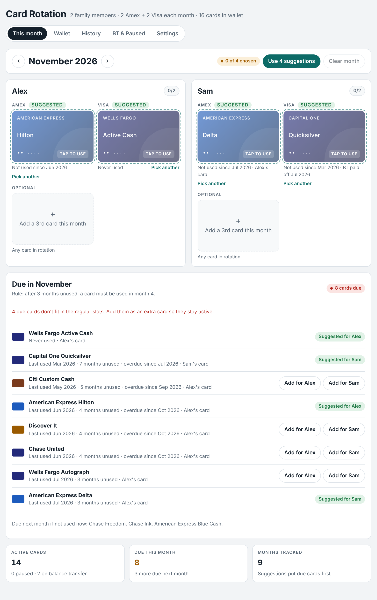

# Card Rotation

Plan which credit cards each family member uses every month, keep every card active, and keep balance-transfer and bill cards out of the way.



## What it does

- **Guided setup.** Asks how many family members will use the cards, their names, and your monthly rule.
- **Monthly suggestions.** Each person gets an Amex slot and a Visa slot (configurable), plus an optional 3rd card. The app suggests the card that has gone longest without use.
- **Due-card rule.** After a card goes unused for 3 months (configurable), it must be used in month 4. Due cards are listed every month with one-tap buttons to add them.
- **Wallet.** Every card with its bank, network, holder, last-used month and "use by" month. Only the last 4 digits are ever stored.
- **Update last used.** Record when a card was last used, one card at a time or many at once, and remove a wrong month to correct it.
- **BT & Paused.** Flag cards on a balance transfer or paused for a bill. Track when each transfer started, when the promo ends and when it was paid off.
- **History.** Who used which card, month by month.
- **Import past usage** from an Excel or CSV file or pasted text, with a preview before anything is saved. Re-importing the same sheet is safe.
- **Backup and restore** everything as one block of text.
- **Works offline** and installs to a phone's home screen.

## Try it

Open `index.html` in a browser, or host the folder on any static web host.

### Publish on GitHub Pages

1. Create a new repository on GitHub and upload the contents of this folder (keep the folder structure).
2. In the repository, open **Settings → Pages**.
3. Under **Build and deployment**, choose **Deploy from a branch**, pick `main` and `/ (root)`, and save.
4. After a minute the app is live at `https://<your-user>.github.io/<repo-name>/`.
5. On a phone, open that link and use **Add to Home Screen** to install it.

## Where data is kept

In this version all data is saved **on the device** (browser local storage). Each phone or browser keeps its own copy, so family members on different phones don't see each other's picks yet. Use **Settings → Back up or move your data** to copy everything from one device to another.

Shared family sync needs a sign-in backend and is on the roadmap below.

## Import format

One row per card. The first column names the holder, the bank and the card. An optional `BT` column with a check mark flags a balance transfer. Other cells say who used the card and in which month.

| Card | BT | Purchase | Purchase |
|---|---|---|---|
| Sam Chase Sapphire | | Sam Sept | Sam May |
| Sam Capital One Quicksilver | | BT Jul | Sam March |
| Alex Citi Simplicity | ✓ | | |
| Alex Wells Active Cash | | Phone Bill | |

- `BT Jul` means a balance transfer paid off in July.
- Months without a year are placed in the most recent matching month.
- Anything else (like `Phone Bill`) is saved as a note on the card.

A ready-to-try file is in [`samples/sample-usage.csv`](samples/sample-usage.csv). More detail is in [`docs/TRAINING.md`](docs/TRAINING.md).

## Project layout

```
index.html              The whole app (HTML, CSS and JavaScript in one file)
manifest.webmanifest    Install-to-home-screen details
sw.js                   Offline support
icons/                  App icons
docs/TRAINING.md        Screen-by-screen training guide
docs/APP-STORES.md      How to package for the Apple App Store and Google Play
docs/screenshots/       Screenshots used in the docs (sample family)
samples/                Sample import file
scripts/build-web.mjs   Copies the app into www/ for the Capacitor build
capacitor.config.json   Settings for wrapping the app for iOS and Android
package.json            Scripts for the Capacitor build
PRIVACY.md              What the app stores and where
CHANGELOG.md            Release notes
```

## Roadmap

- Family sync across phones (sign-in plus a hosted database such as Firebase or Supabase).
- Reading a screenshot of a tracking sheet in the standalone version (needs an AI service behind a server).
- App Store and Google Play releases (see `docs/APP-STORES.md`).

## License

MIT. See [LICENSE](LICENSE).
